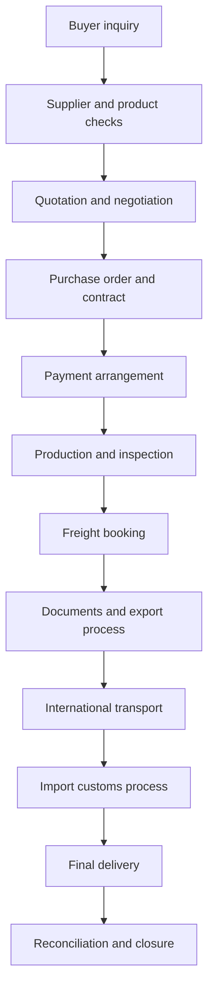

# ITC-01 · Lesson 01 — Introduction to International Trade

**Level:** Intermediate foundation  
**Estimated study time:** 60–90 minutes  
**Languages:** English · Hindi · Thai  
**Lesson ID:** ITC-01-LES-01

## 1. Learning objectives

After completing this lesson, you should be able to:

1. Define international trade in precise terms.
2. Explain the meaning of cross-border exchange.
3. Distinguish goods from services in trade.
4. Identify the basic buyer, seller, origin and destination.
5. Explain why an International Trade Coordinator is needed.
6. Describe a simple international transaction.
7. Use the key terms in English, Hindi and Thai.

## 2. Prerequisite knowledge

You should understand the basic meaning of a buyer, seller, product, service, price and payment. No specialist customs or logistics knowledge is required for this lesson.

## 3. Key terminology — English, Hindi and Thai

| English term | Hindi meaning | Thai | Practical meaning |
|---|---|---|---|
| International trade | अंतरराष्ट्रीय व्यापार | การค้าระหว่างประเทศ | Exchange across national borders |
| Domestic trade | घरेलू व्यापार | การค้าภายในประเทศ | Trade within one country |
| Import | आयात | การนำเข้า | Bringing goods/services into a country |
| Export | निर्यात | การส่งออก | Supplying goods/services to another country |
| Buyer | खरीदार | ผู้ซื้อ | Party purchasing |
| Seller | विक्रेता | ผู้ขาย | Party selling |
| Supplier | आपूर्तिकर्ता | ผู้จัดหา | Party supplying products/services |
| Manufacturer | निर्माता | ผู้ผลิต | Party making a product |
| Shipment | माल की खेप | การขนส่งสินค้า / สินค้าที่จัดส่ง | Consignment being transported |
| Destination | गंतव्य | ปลายทาง | Intended receiving place |
| Origin | मूल स्थान / उत्पत्ति | แหล่งกำเนิด | Place of origin, depending on context |
| Customs | सीमा शुल्क विभाग / सीमा शुल्क | ศุลกากร | Border authority and customs processes |
| Freight | माल ढुलाई | ค่าระวาง / การขนส่งสินค้า | Transport service or charge, by context |
| Invoice | बीजक / इनवॉइस | ใบแจ้งหนี้ | Commercial billing document |
| Payment | भुगतान | การชำระเงิน | Settlement of an amount due |
| Coordinator | समन्वयक | ผู้ประสานงาน | Person coordinating parties and tasks |

Thai pronunciation is approximate and should be checked with a fluent speaker or reliable audio dictionary for workplace use.

## 4. Formal definition

**International trade** is the exchange of goods and/or services between parties located in different countries or customs territories, subject to applicable commercial agreements, transport arrangements, payment systems and relevant laws and regulations.

The exact legal treatment of a transaction depends on the countries, customs territories, product or service, and applicable rules.

### Hindi explanation

अंतरराष्ट्रीय व्यापार का अर्थ है दो अलग-अलग देशों या सीमा-शुल्क क्षेत्रों में स्थित पक्षों के बीच वस्तुओं या सेवाओं का खरीदना, बेचना या आदान-प्रदान करना।

उदाहरण: Thailand की एक कंपनी China की कंपनी से मशीन खरीदती है। यह सीमा-पार व्यापार है क्योंकि खरीदार और विक्रेता अलग-अलग देशों में हैं।

### Thai explanation

การค้าระหว่างประเทศ คือ การซื้อขายหรือแลกเปลี่ยนสินค้าและบริการระหว่างผู้ซื้อและผู้ขายที่อยู่คนละประเทศหรือเขตศุลกากร

Example: บริษัทในประเทศไทยซื้อเครื่องจักรจากบริษัทในประเทศจีน

## 5. What can be traded?

International trade includes more than physical products.

### A. Goods — वस्तुएँ — สินค้า

Examples:
- Machinery and equipment
- Clothing and textiles
- Food and agricultural products
- Electronics
- Raw materials
- Vehicle parts

Goods may require transport, packaging, classification, customs declarations, product approvals and other controls.

### B. Services — सेवाएँ — บริการ

Examples:
- Software development
- Consulting
- Design services
- Engineering services
- Education services
- International business support

Services may be supplied remotely or through movement of people, consumers or commercial presence. Their tax, regulatory and reporting treatment can differ from goods.

## 6. Why does international trade happen?

Countries and businesses trade because resources, production capabilities, technology, costs, skills and consumer demand differ.

### Main reasons

1. **Resource differences:** A country may have natural resources or agricultural conditions that another country lacks.
2. **Specialization:** Businesses focus on products or services they can produce efficiently.
3. **Cost and productivity:** Production costs and capabilities vary.
4. **Consumer choice:** Buyers seek products not available locally or prefer imported alternatives.
5. **Technology and knowledge:** Trade can enable access to specialized equipment and services.
6. **Market expansion:** Sellers reach customers beyond their domestic market.
7. **Supply-chain integration:** Firms source components from multiple countries.

Trade can create benefits, but it also introduces exposure to exchange-rate changes, transport disruption, regulatory differences, quality problems and political or commercial risks.

## 7. Basic international trade example

**Training scenario — fictional data**

- Seller/exporter: Shenzhen Example Machinery Co., China
- Buyer/importer: Bangkok Example Manufacturing Co., Thailand
- Product: 10 industrial pumps
- Illustrative unit price: USD 500
- Illustrative goods value: USD 5,000
- Destination: Bangkok, Thailand

### Transaction interpretation

1. A Thai buyer requests a quotation.
2. The Chinese seller provides product specifications and a quotation.
3. The parties negotiate price, delivery rule and payment terms.
4. The buyer issues or confirms a purchase order.
5. The parties finalize their sales contract.
6. The seller prepares the goods and agreed documents.
7. A freight provider transports the goods.
8. Export and import customs procedures are coordinated.
9. The buyer receives the goods.
10. The parties reconcile payment and close the order.

The example is educational. It does not specify a real tariff classification, duty rate, permit, tax treatment or required certificate.

## 8. Who is involved?

| Participant | Main function |
|---|---|
| Buyer / Importer | Purchases and receives goods |
| Seller / Exporter | Sells and supplies goods |
| Manufacturer | Produces the goods |
| Supplier | Provides products or inputs |
| Freight forwarder | Arranges transport services |
| Carrier | Physically transports cargo |
| Customs authority | Administers customs laws and procedures |
| Customs broker / declarant | Provides authorized declaration or clearance services, where applicable |
| Bank / payment provider | Processes payment and trade finance services |
| Insurer | Provides agreed cargo or trade-risk cover |
| Inspector | Performs agreed inspection or testing |
| Trade Coordinator | Tracks tasks, information, documents and communication |

### Coordinator's responsibility boundary

A coordinator organizes and verifies the operational process. The coordinator does not automatically have authority to:
- Make legal determinations.
- Certify product origin or quality without authority.
- Act as a licensed customs broker.
- Approve bank payments.
- Guarantee customs release.
- Change contract terms without approval.

The coordinator escalates decisions to the authorized company manager, customs professional, bank, insurer, legal adviser or relevant authority.

## 9. The transaction lifecycle

At each stage, the coordinator should record:
- Unique order or shipment reference.
- Responsible person.
- Required action.
- Due date.
- Current status.
- Supporting evidence.
- Open issue and escalation owner.

## 10. Essential distinction: import and export

The same transaction can be an export from the seller's country and an import into the buyer's country.

For the example above:
- From China's perspective, the movement is an export.
- From Thailand's perspective, the movement is an import.

**Hindi:** एक ही shipment भेजने वाले देश के लिए निर्यात और प्राप्त करने वाले देश के लिए आयात हो सकती है।

**Thai:** การขนส่งเดียวกันอาจเป็นการส่งออกของประเทศต้นทาง และเป็นการนำเข้าของประเทศปลายทาง

## 11. Common beginner mistakes

| Mistake | Correct understanding |
|---|---|
| Calling every foreign purchase an export | It is an import for the receiving buyer/country |
| Assuming goods and services follow identical procedures | Their regulatory and operational treatment can differ |
| Treating a quotation as a final contract | Contract formation depends on the parties' agreement and applicable law |
| Assuming the coordinator approves customs clearance | Customs authority or authorized process controls release |
| Assuming freight price equals landed cost | Duties, taxes, insurance, handling and other costs may apply |
| Treating an AI suggestion as official compliance advice | Verify with authoritative sources and qualified professionals |

## 12. Practical assignment — LAB-ITC01-01

### Scenario

A company in Thailand purchases 1,000 units of a product from a manufacturer in China.

Prepare a one-page transaction map containing:

1. Buyer company and country.
2. Seller company and country.
3. Product and quantity.
4. Importing country.
5. Exporting country.
6. At least six other parties who may participate.
7. Ten major transaction steps.
8. Three risks and a suitable escalation owner for each.

### Deliverables

- One PDF or document transaction map.
- One spreadsheet stakeholder register.
- At least 15 English-Hindi-Thai terms.

### Evaluation rubric

| Criterion | Marks |
|---|---:|
| Correct identification of buyer and seller | 15 |
| Import/export interpretation | 15 |
| Stakeholder identification | 20 |
| Workflow completeness | 25 |
| Risk and escalation mapping | 15 |
| Terminology accuracy | 10 |
| **Total** | **100** |

Suggested pass mark: 70%.

## 13. Knowledge check

Answer without looking at the answer key first.

1. What is international trade?
2. What is the difference between goods and services?
3. A Thai company buys products from China. Which country is the import destination?
4. From China's perspective, is the transaction an import or export?
5. Name four participants other than the buyer and seller.
6. What does an International Trade Coordinator coordinate?
7. Does a freight quotation automatically represent the total landed cost?
8. Who should verify a product's applicable import permit requirements?

## 14. Answer key

1. Cross-border exchange of goods and/or services between parties in different countries or customs territories.
2. Goods are physical or otherwise classified products; services are activities or deliverables supplied to a customer.
3. Thailand.
4. Export.
5. Possible answers: manufacturer, forwarder, carrier, customs authority, broker, bank, insurer or inspector.
6. Tasks, information, stakeholders, timelines, documents, status and escalation.
7. No. Other costs may include insurance, duty, taxes, handling and local charges.
8. The importer should verify with the relevant official authority and qualified customs professional, with the coordinator supporting the process.

## 15. Lesson completion checklist

- [ ] I can define international trade.
- [ ] I can explain goods and services.
- [ ] I can distinguish import from export.
- [ ] I can identify transaction participants.
- [ ] I can explain the coordinator's responsibility boundary.
- [ ] I completed LAB-ITC01-01.
- [ ] I answered the knowledge check.
- [ ] I recorded unfamiliar English, Hindi and Thai terms.

## 16. References and further study

- World Trade Organization (WTO): https://www.wto.org/
- World Customs Organization (WCO): https://www.wcoomd.org/
- International Chamber of Commerce (ICC): https://iccwbo.org/
- Thailand Customs Department: https://www.customs.go.th/
- Thailand Department of Foreign Trade: https://www.dft.go.th/

Use official and current sources when applying the lesson to an actual transaction.

---

**End of ITC-01-LES-01**

**Next lesson:** ITC-01-LES-02 — Domestic Trade vs International Trade.
